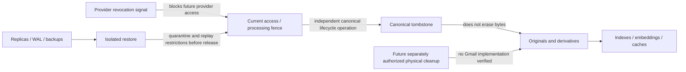

# Gmail synthetic storage and copy inventory v1

**Scope:** offline repository inventory only. It describes candidate stores and
current repository seams; it does not claim that Gmail data is present, that a
store is exhaustive, or that cleanup works end to end. `#876` Option C NO-GO
remains effective. No Gmail API, mailbox, credentials, retention duration,
physical deletion, or compliance result is represented here.

**Evidence baseline:** repository revision `a5758eb364b117ef3f96c8e97cdf1769527ea762`;
artifact taxonomy from [issue #820](https://github.com/alkselsv/spine/issues/820).
Every evidence statement below was checked against that revision. The inventory
remains a repository seam survey; it does not establish operational deployment
ownership or exhaustive coverage.
Absence of evidence is `NOT_VERIFIED`, not proof of absence.

## State boundaries

Provider revocation, access/processing fences, canonical tombstones, physical
artifact cleanup, and backup disposition are separate controls. A tombstone
changes canonical current-source state and fences ordinary retrieval under
ADR-0018; it is not proof that payload copies were erased. Existing isolated
restore proves an isolated restore path for its declared recovery set, not
replay of a Gmail deletion ledger.

## Repository seams and limits

| Concern | Exact repository owner/interface evidence | Verified coverage and limit |
|---|---|---|
| Canonical source/revision and lifecycle | `src/spine/domain/sources/models.py`; `src/spine/domain/sources/canonical_tombstone_selector.py`; PostgreSQL canonical persistence under `src/spine/infrastructure/persistence/`; `tests/domain/sources/test_canonical_tombstone_v3.py`; [ADR-0018](../adr/0018-canonical-source-and-projection-publication-lifecycle.md) | Immutable revisions, versioned tombstone authorization linkage, and explicit writer-mode fencing exist. These govern canonical tombstone acceptance only; no Gmail-specific payload purge or residual-lineage allowlist. |
| Email artifacts and access/processing admission | `src/spine/domain/artifacts/email_governance.py`; `src/spine/application/email_artifacts.py`; tests `tests/application/test_email_artifacts.py`, `test_email_governance.py` | Five coarse email retention classes, lineage, AccessPolicy and RetentionApplicability checks exist. The five classes cannot represent #820's 20 classes losslessly. No physical-delete completion evidence. |
| Retention applicability | `src/spine/domain/sources/retention.py`; `src/spine/application/retention.py`; [ADR-0057](../adr/0057-retention-applicability-authority.md) | Binding is eligibility/policy applicability, not cleanup authorization; no Gmail term is approved. |
| Original object storage and receipts | `src/spine/application/storage/`; `src/spine/infrastructure/object_storage/`; `tests/contracts/object_storage/`; `tests/integration/object_storage/` | Write/read/receipt and selected deletion/reconciliation seams exist. Gmail-specific class mapping, all-version purge and complete store coverage are `NOT_VERIFIED`. |
| Parsed body and attachment artifacts | `src/spine/ingestion/email_mime.py`; `src/spine/application/email_attachments.py`; `src/spine/application/persistence/parsed_artifacts.py`; tests under `tests/ingestion/` and `tests/application/test_email_attachment*` | Parse, sanitize, persist and lineage behavior is present. Cleanup across parser temp files, artifact copies, caches and retries is `NOT_VERIFIED`. |
| Projections and physical cleanup | `src/spine/application/projection_recovery_execution.py`; `src/spine/memory/cognee/`; [ADR-0027](../adr/0027-physical-projection-cleanup-and-repair.md) | Selected failed/retired projection artifacts have a soft idempotent cleanup/recovery seam. Exhaustive Gmail projection/index/embedding removal and cache purge are `NOT_VERIFIED`. |
| Outbox and work delivery | `src/spine/application/persistence/outbox.py`; `src/spine/infrastructure/outbox/`; `src/spine/workers/`; [ADR-0004](../adr/0004-transactional-outbox-foundation.md) | Typed transactional intents and delivery/retry exist. Gmail-specific cleanup events, queue payload inventory and purge are `NOT_VERIFIED`. |
| Audit and diagnostics | `src/spine/domain/audit/`; `src/spine/application/diagnostics/`; `src/spine/api/diagnostics.py`; [ADR-0020](../adr/0020-canonical-audit-and-diagnostic-separation.md) | Separate audit/diagnostic contracts exist. Gmail-specific forbidden-field scans and cleanup evidence profile are `NOT_VERIFIED`; no identifier or digest is assumed safe. |
| Backup and restore | `src/spine/infrastructure/isolated_restore.py`; `src/spine/infrastructure/backup_artifacts.py`; `src/spine/infrastructure/postgres_backup.py`; `tests/integration/object_storage/test_original_storage_backup.py`; [ADR-0022](../adr/0022-durable-backup-fence-and-recovery-evidence.md) | Generic recovery manifests, isolated restore and verification seams exist. Gmail copy coverage, backup/WAL disposition, deletion-ledger replay and post-replay denial are `NOT_VERIFIED`. |
| Existing deletion/revocation authority | [#812](https://github.com/alkselsv/spine/issues/812), [#813](https://github.com/alkselsv/spine/issues/813), [#976](https://github.com/alkselsv/spine/issues/976), [#857](https://github.com/alkselsv/spine/issues/857) | #812 is an authorization/idempotency pattern, #813/#976 own publication/revocation fences, #857 covers email access/retention and excludes physical deletion. No seam is a Gmail cleanup authority. |

## #820 class inventory

All rows are candidate surfaces. `Owner` is the current repository module or
operational owner implied by evidence, not an assigned human cleanup owner.
`Coverage` is deliberately `NOT_VERIFIED` for Gmail end-to-end disposition in
every row: current Option C denies live Gmail content, and no Gmail copy
inventory or cleanup run is evidenced. Existing generic seams are noted without
promoting them to proof.

| #820 class | Candidate stores/copies | Repository owner/evidence | Existing seam / known coverage | Gap / status |
|---|---|---|---|---|
| 1. Raw MIME/RFC822 originals | Original object, object versions, receipt/association, upload chunks, orphan object, replica/backup/WAL | Email MIME `src/spine/ingestion/email_mime.py`; object storage `src/spine/infrastructure/object_storage/`; canonical association `src/spine/application/persistence/canonical.py` | Object receipts and orphan reconciliation exist generically | All-copy deletion and Gmail linkage `NOT_VERIFIED` |
| 2. Headers/addresses | Canonical source observations, parsed artifact metadata, outbox, indexes, diagnostics | Email artifacts `src/spine/application/email_artifacts.py`; canonical persistence | Email parser/artifact contracts exist | Field-level coverage and allowed surviving fields `NOT_VERIFIED` |
| 3. Plain-text body | Parsed artifact rows/objects, queue payloads, answer/context cache, backups | Parsed artifacts `src/spine/application/persistence/parsed_artifacts.py`; email artifact application | Persistence and access admission exist | Purge from each copy and backup `NOT_VERIFIED` |
| 4. Parsed HTML | Parser intermediates, sanitized HTML, artifacts, staging/temp, cache | `src/spine/ingestion/email_mime.py`; `src/spine/ingestion/email_html.py` | Parse/sanitize tests exist | Intermediate/temp cleanup and residual copies `NOT_VERIFIED` |
| 5. Sanitized content | Artifact rows/objects, projection inputs, outbox, caches | `src/spine/ingestion/email_html.py`; email artifact application | Sanitization and source lineage exist | Physical derivative closure `NOT_VERIFIED` |
| 6. Attachment originals | MIME part bytes, object/version, upload staging, receipts, orphan files | `src/spine/application/email_attachments.py`; object storage | Attachment ingestion and object receipts exist | Parent/part copy closure and all versions `NOT_VERIFIED` |
| 7. Attachment-derived text | Extracted text, parser output, staging, search/projection inputs, cache | Email attachment application; ingestion parsers | Attachment ingestion tests exist | All derived copies and cleanup `NOT_VERIFIED` |
| 8. Attachment-derived structured artifacts | Tables, extracted fields, generated documents, DB/object copies and queues | Email attachment application; parsed artifact persistence | Typed artifact handling exists in selected paths | Per-format store map and purge `NOT_VERIFIED` |
| 9. Thread/conversation metadata | Canonical relationship rows, labels, indexes, event/outbox, caches | Canonical source persistence; email artifacts | Source lineage/identity contracts exist | Complete relationship/index deletion coverage `NOT_VERIFIED` |
| 10. Provider message/folder identifiers | Provider observations, source provenance, checkpoints, logs, indexes | `src/spine/domain/sources/google.py`; `src/spine/application/` email sync | Provider identity/checkpoint contracts exist | Surviving-field decision and copy inventory `NOT_VERIFIED`; no field presumed safe |
| 11. SourceObject/SourceRevision identity and lineage | Canonical DB, receipt associations, provenance, audit/outbox joins, derived lineage | `src/spine/domain/sources/models.py`; `src/spine/domain/sources/canonical_tombstone_selector.py`; canonical persistence; ADR-0018 | Immutable identity/provenance and v3 tombstone authorization linkage exist; this does not authorize Gmail cleanup | HD1 field decision; no cleanup lineage is approved; `NOT_VERIFIED` |
| 12. Search indexes | Search namespace/index, rebuild inputs, event queues, replicas | Projection owner: `src/spine/application/projection_publication.py`, `src/spine/infrastructure/persistence/projection.py`, `src/spine/memory/cognee/context_projection.py` | Publication and recovery seam: `src/spine/application/projection_recovery_execution.py` for selected failed/retired artifacts | Gmail-specific index inventory, complete deletion and negative-query proof `NOT_VERIFIED` |
| 13. Vector embeddings/projections | Cognee/vector namespaces, shadow/retired builds, replicas, persisted inputs | Projection owner: `src/spine/memory/cognee/context_projection.py`; recovery adapter: `src/spine/memory/cognee/recovery.py`; ADR-0027 | `recovery.py` exposes selected failed/retired namespace cleanup and repair only | Exhaustive Gmail namespace, replica and cache deletion `NOT_VERIFIED` |
| 14. Generated summaries | Workflow artifacts, canonical/artifact store, notification and event payloads | Candidate workflow owners: `src/spine/domain/workflows/`, `src/spine/application/persistence/workflow_runs.py`, `src/spine/infrastructure/persistence/postgresql_workflow_runs.py` | Typed workflow-run persistence exists; no Gmail-summary deletion seam identified | Gmail summary producers, lineage closure, all copies and purge `NOT_VERIFIED` |
| 15. Monitoring evidence | Findings/workflow artifacts, notification payloads, audit references | Candidate contracts: `src/spine/domain/findings/`, `src/spine/domain/workflows/`, `src/spine/domain/audit/models.py` | Workflow and audit contracts exist; no Gmail-specific evidence cleanup seam identified | Exact Gmail evidence fields, destinations, copies and purge `NOT_VERIFIED` |
| 16. Staging artifacts | Multipart uploads, parser scratch, retry/work queues, abandoned uploads | Upload owner: `src/spine/application/storage/upload.py`; reconciliation: `src/spine/application/storage/reconciliation.py`; email parser: `src/spine/ingestion/email_mime.py` | Upload lifecycle and generic object reconciliation tests exist | Gmail-specific staging enumeration and complete sweep evidence `NOT_VERIFIED` |
| 17. Temporary files/caches | Temp files, process cache, answer/citation cache, object cache, retry cache | Candidate runtime owners: `src/spine/application/answer_question_attempts.py`, `src/spine/api/authorized_ask.py`, `src/spine/memory/cognee/context_projection.py`, `src/spine/application/storage/upload.py` | Some bounded query/projection/storage lifecycle paths exist; no global cache/temp inventory or cleanup interface found | Per-cache owner coverage, Gmail copy inventory and purge proof `NOT_VERIFIED` |
| 18. Replicas/backups | PostgreSQL replicas/WAL/archive, snapshots, object versions, exported backups | Backup/restore owners: `src/spine/infrastructure/postgres_backup.py`, `src/spine/infrastructure/backup_artifacts.py`, `src/spine/infrastructure/isolated_restore.py`; ADR-0022 | Generic backup artifacts and isolated restore evidence | Gmail copy topology, approved disposition and deletion-restriction replay `NOT_VERIFIED` |
| 19. Audit records | Audit rows/events, outbox, export, replicas/backups | Audit owners: `src/spine/domain/audit/models.py`, `src/spine/application/diagnostics/audit.py`, `src/spine/infrastructure/persistence/canonical_audit.py`; ADR-0020 | Audit writer seams and contract tests exist; no Gmail cleanup seam identified | Gmail field decision, allowed retention rule and purge boundary `NOT_VERIFIED` |
| 20. Operational diagnostics | Logs, traces, metrics, exception/error records, worker diagnostics | Telemetry/diagnostic owners: `src/spine/infrastructure/telemetry/diagnostics.py`, `src/spine/infrastructure/diagnostics/sinks.py`, `src/spine/api/diagnostics.py` | Safe error-code and bounded diagnostic patterns exist | Gmail-specific redaction scan, complete sink inventory and purge seam `NOT_VERIFIED` |

## Reuse limits and verification

- Reuse `RetentionApplicability` for eligibility only; do not create a second
  retention or approval registry.
- Reuse `AccessPolicy` and existing lifecycle/generation checks for reads and
  processing. They do not authorize physical deletion.
- Reuse #812's current-authority/idempotency/audit pattern and #813/#976's
  publication/revocation fence at their established boundaries; neither is
  silently extended into Gmail cleanup.
- Reuse object-storage orphan reconciliation and projection cleanup only for
  their declared targets. They do not prove exhaustive coverage.
- #857 remains an access/retention control, not a physical deletion mechanism.
- A canonical tombstone, opaque reference, UUID, digest, audit record, or
  metadata label does not make a value safe to retain.

Checklist: confirm the table has 20 numbered rows; each has a candidate copy,
code/operational owner, evidence/seam, coverage statement, and `NOT_VERIFIED`
gap. This document reports inventory only and makes no physical-erasure claim.
