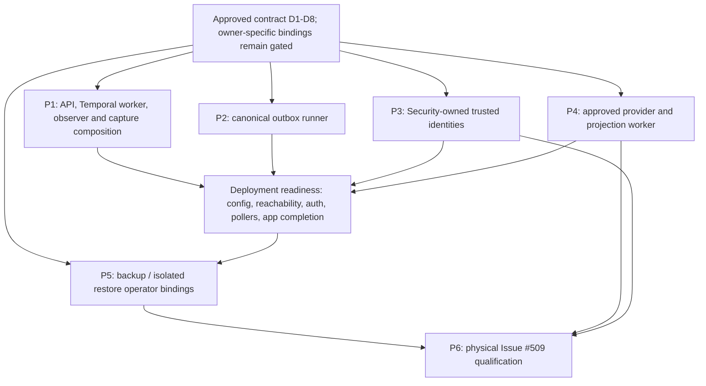

# Issue #509 production composition implementation handoff

**Contract:** [`spine-production-deployment-composition:v1`](issue-509-production-composition-contract.md)
**Status:** **ARCHITECTURE APPROVED — recorded by `dima55279` based on team lead approval communicated outside GitHub on 2026-10-21; [approval record](https://github.com/alkselsv/spine/pull/528#issuecomment-6317606512).**
**GitHub review:** The participant-authored comment is not a formal GitHub review from the team lead.
**Publication rule:** P1–P5 are authorized for implementation-ticket publication after live tracker/ownership reconciliation. They do not carry Security, Provider, Storage/Recovery, operator or release approvals by implication. Do not assign or claim them without owner agreement.

## 1. Existing ticket reconciliation

| Existing item | Current tracker state | Handoff treatment |
| --- | --- | --- |
| #469 Production `AnswerQuestionCapability` composition | Closed | Reuse its implemented capability and application boundary. Do not recreate it. |
| #476 Shared API/Temporal durable Q&A composition | Closed | Reuse `DurableAskComposition`, outbox bindings and workflow ownership. Do not add a second path. |
| #478 Production observer integration | Closed, currently still carries an `in-progress` label | Reuse its observer/capture composition. Do not change its label/assignees in this handoff. |
| #506 Production runtime composition/trusted readiness | Closed; #512 and #513 comments record code/readiness and disposable integration. #513 explicitly leaves live deployment reachability and existing authorization unverified. The contract document maps all nine ACs and their residual evidence. | New deployment-wiring issues are children of the open #16 release gate and link #506 as prior implementation. Ask current owners to reconcile residual acceptance ownership; do not reopen automatically or claim residual ACs complete. |
| #507 Canonical ingestion/physical projection qualification | Closed and referenced as a native blocker for #509; latest records leave deployed R4 and composed live R6 outstanding and report a NO-GO on canonical receipt mapping. | P4 is limited to deployment wiring. Reuse profile/code only after owner confirmation; the current #507 owner must reconcile residual physical/adapter work. Preserve #507 → #509; do not reopen or reparent #507. |
| #5, #18, #362, #363, #364, #368, #369 | Closed contracts/implementation/exercises | Reuse their accepted interfaces and runbooks. Closure is not evidence of this deployment's identity, destination, restore, projection, or canary readiness. |
| #509 Backup, isolated restore and recovery qualification | Open / `in-progress`, assigned to `dima55279` and `Ocskylla` | Remains the physical qualification issue and current ownership lock. No claim, reassignment, or closure change is proposed. |
| #16 production qualification spec | Merged and accepted | System-level release criteria remain authoritative for R2/R3/R13 and final GO/NO-GO. |

The current native dependency query lists #507 as a blocker of #509 although #507 is closed. Its evidence report still marks deployed R4/composed R6 incomplete; do not treat the closed dependency edge as proof that those conditions are met. Resolve the tracker relationship with owners rather than editing it as part of this documentation PR.

## 2. Proposed implementation tickets

### P1 — Deploy the approved production composition for API, worker and observer

- **Proposed title:** `Deploy the approved production API, Temporal worker and observer composition`
- **Parent / owner:** #16 release gate (native sub-issue); Runtime owner. Reference #506 as prior implementation. Security identity approval is a runtime prerequisite owned separately by P3.
- **Problem:** Existing `compose_durable_ask()` and `DurableAskComposition` can construct the API path, worker factory and observer binding, but no process entrypoint loads validated configuration, starts the right lifecycle, or reports deployed readiness for API and worker; the observer/capture binding has not been verified against that deployment.
- **Scope:** Implement only the approved versioned settings binding and one production composition root; API and worker process-specific entrypoints; canonical PostgreSQL + trusted-context bindings; existing API and Temporal factories; bind the existing observer/capture contract to the same logical composition and its current approved runner topology; authenticated ephemeral same-execution capture where that topology separates worker and observer; bounded lifecycle; compatible profile identity checks; safe readiness. Do not add an observer process solely for this contract. Preserve API admission-only behavior and existing Temporal workflow/activity contracts.
- **Out of scope:** New Q&A runtime, auth model, persistence, workflow engine, provisioning, provider calls at startup, production rollout, recovery operator, private corpus or executing the #453 Golden Dataset benchmark.
- **Inputs:** Approved D1/D2/D4; ADR-0021/0038/0040; `ProductionRuntimeProfile:v1`; #527 worker factory; existing PostgreSQL settings and migrations.
- **Acceptance:** API uses current trusted canonical authorization and PostgreSQL; worker uses matched namespace/task queue/database/profile and actually polls; the observer is bound to the compatible logical composition and the existing approved capture topology; capture is registered before admission and correlates only the same worker execution and current authorized disclosure; a supported synthetic ask passes API → PostgreSQL admission/outbox → worker → Temporal → canonical terminal persistence and completes successfully; mismatches fail closed; process shutdown is bounded. This proves composition, not benchmark qualification.
- **Tests:** Deterministic composition and capture-correlation contracts; PostgreSQL 17 role/RLS/API integration; real Temporal SDK service integration for task delivery and terminal persistence; capture integration at the worker/observer boundary according to the existing topology (without introducing a new process); positive/negative scope authorization; process lifecycle and safe-error tests; full pytest/compileall/domain boundary/R1 gates.
- **Dependencies:** Approved D1/D2; #527 is merged; #478 observer and ADR-0040 capture contracts are inputs. P1 and P3 can be implemented in parallel, but deployed trusted-authorization checks and the completed synthetic application scenario require P3 identities. Any provider-backed scenario also requires P4 profile and run-specific spend approval. No private corpus or Golden Dataset benchmark is used.
- **Parallelism:** Can proceed alongside P2 lifecycle work after the shared settings and profile identity contract is approved.
- **#509 blocker:** Without real API/worker/observer-compatible composition and trusted authorization, no application readiness or authorized canary.

### P2 — Run the existing PostgreSQL outbox dispatcher as a bounded process

- **Proposed title:** `Deploy the canonical Ask and projection outbox dispatcher`
- **Parent / owner:** #16 release gate (native sub-issue); Runtime/Operations owner.
- **Problem:** `OutboxWorker.dispatch_batch()` and the PostgreSQL delivery repository are bounded seams, but no runner owns polling, consumer registration, retry/lease settings and shutdown.
- **Scope:** Bind `create_outbox_worker()` and `create_production_outbox_worker()` to the same approved root; explicitly register Ask admission, cancellation and projection/recovery routes; use the dispatcher-only role; implement bounded polling, retry/lease limits, diagnostics and graceful stop.
- **Out of scope:** New queue/broker, second dispatcher, direct provider or workflow calls, unbounded background threads, broad database grants.
- **Inputs:** ADR-0038, #287/#364 outbox routes, `OutboxDispatcher`, dispatcher role settings, approved D2/D3.
- **Acceptance:** Real SOURCE process delivers one idempotent Ask dispatch and one approved projection request through canonical routes; redelivery creates one logical outcome; role cannot read unrelated tenant data; stop/restart preserves lease/retry semantics.
- **Tests:** Dispatcher process lifecycle; disposable PostgreSQL integration for role boundaries, lease expiry, retry, duplicate delivery and cooperative shutdown; safe diagnostic scan.
- **Dependencies:** D1/D2/D3; P1 for Ask end-to-end, but projection route and dispatcher core can be prepared in parallel with P1.
- **#509 blocker:** No reliable API → outbox → Temporal application execution or deployed projection recovery worker.

### P3 — Approve and bind synthetic trusted qualification identities

- **Proposed title:** `Provide a Security-owned synthetic qualification identity binding`
- **Parent / owner:** #5 Identity/authorization domain (native sub-issue); Security owner. #5 is closed and will not be reopened or modified. P3 is limited to the qualification-specific approved binding not supplied by existing implementation.
- **Problem:** Canonical auth resolution exists, but no reviewed production-capable method creates or selects scoped temporary identities for isolated qualification. Development local bearer settings and `PostgreSQLAuthorizationSeedHelper` do not satisfy trusted authorization.
- **Scope:** Identify an existing security-owned provisioning path or propose a narrowly scoped operator mechanism; specify lifecycle/expiry/revocation, human vs service identities, Workspace/Environment membership, least-privilege roles, RLS and audit behavior; bind independent SOURCE and RESTORE identities.
- **Out of scope:** General user/admin provisioning product, auth redesign, token-claim authority, test helper promotion, blanket grants or RLS/AccessPolicy relaxation.
- **Inputs:** ADR-0021, canonical identity/membership/grant schema and policies, accepted D4.
- **Acceptance:** Security reviewer approves the mechanism; actual synthetic positive/negative scope tests, cross-workspace/environment denial, role separation and revocation pass; credentials remain external and evidence contains no values.
- **Tests:** PostgreSQL authorization integration tests with two workspaces/environments; AccessPolicy and RLS denial checks; audit/redaction tests.
- **Dependencies:** No implementation blocker after approved D4. P3 can run in parallel with P1/P2; P1 deployed trusted-authorization checks and #509 readiness require P3 completion. Any new provisioning contract remains blocked on Security decision.
- **#509 blocker:** Trusted runtime authorization, recovery verifier separation and authorized canary.

### P4 — Bind the approved Context Projection profile and recovery worker

- **Proposed title:** `Bind the approved Cognee profile to the canonical projection worker`
- **Parent / owner:** #16 release gate (native sub-issue); Projection/Provider owner. Coordinate residual acceptance with the current #507 owner; do not change #507 ownership/status.
- **Problem:** Cognee adapter, canonical PostgreSQL request resolver, physical qualification evidence and projection recovery route exist, but no approved run-specific provider credentials, settings, limits or deployed worker binding is supplied.
- **Scope:** Confirm whether #507's exact Cognee 1.5.4 / PostgreSQL 17 / Neo4j/APOC 5.26.32 / PGVector 0.8.7 profile remains approved; bind model versions and bounded spend policy; connect the existing physical adapter through the canonical outbox route; preserve active/shadow, lineage and stale/tombstone controls. Hand the still-open deployed R4/composed live R6 evidence to the current #507 owner for explicit ownership reconciliation; do not absorb or duplicate that qualification here.
- **Out of scope:** Alternate provider/fallback, new projection adapter, PostgreSQL projection authority, private Golden Dataset, automatic indexing/re-embedding or unapproved paid calls.
- **Inputs:** ADR-0027/0030, #287/#364, `CogneeContextProjection`, `create_production_outbox_worker()`, exact #507 physical report, approved D5.
- **Acceptance:** Provider owner confirms the profile/version and external secret reference; bounded spend policy is recorded; settings reject unapproved profiles and missing limits; production composition wires the existing provider/recovery consumer to the canonical outbox, with the provider call outside PostgreSQL UnitOfWork; no provider call occurs during startup/readiness.
- **Tests:** Deterministic configuration/fail-closed tests; disposable/opt-in provider and PostgreSQL composition integration only when explicitly authorized; currentness/rebuild/rollback/isolation and provider-failure suites. Do not report these as #507 physical acceptance.
- **Dependencies:** Approved D5 architecture; profile/configuration work proceeds in parallel. The combined deployed projection route is a runtime prerequisite for #509 and uses P2's runner; physical #507/#509 execution remains separate operator qualification and is not a completion criterion for P4.
- **#509 blocker:** Deployment-specific provider readiness and projection recovery evidence remain blocked until the existing #507/#509 qualification owners run and review the authorized physical exercise.

### P5 — Bind the approved recovery operator to existing coordinator and verifier

- **Proposed title:** `Deploy the approved coordinated backup and isolated restore entrypoints`
- **Parent / owner:** #18 operations/recovery domain (native sub-issue); Storage/Recovery owner. #18 is closed and will not be reopened or modified. Reuse #362/#363/#368 and their current contracts.
- **Problem:** `CoordinatedBackupProfile` and `IsolatedRestoreVerifier` have deterministic/integration-tested implementations and runbooks, but no reviewed target-specific entrypoint/configuration.
- **Scope:** Choose one-shot command or owner-managed job; bind ADR-0022 fence/quiescence, PostgreSQL and original-storage components, protected destination/read-back, immutable manifest, separate empty non-serving RESTORE targets and identities, reconciliation, audit and safe failure output. Reuse projection recovery and authorized canary seams; do not introduce new storage/recovery formats.
- **Out of scope:** New backup subsystem, raw manual dump/archive flow, restore over SOURCE, direct filesystem/database edits, automatic promotion, RPO/RTO claim, production operation.
- **Inputs:** ADR-0022, #362/#363/#368/#369 runbooks and code, `docs/storage-backup-profile.md`, approved D6/D7.
- **Acceptance:** Owner-approved binding schema validates SOURCE, protected destination, compatible tools, fence profile, distinct empty non-serving RESTORE targets and role references; launcher invokes only `CoordinatedBackupProfile` / `IsolatedRestoreVerifier` and existing reconciliation; mismatched, shared, non-empty or serving targets fail closed; no startup-triggered or unreviewed operation; safe reports contain no secrets/payloads.
- **Tests:** Existing storage/verifier suites; configuration and target-separation fail-closed tests; disposable PostgreSQL/filesystem contract integration under the runbook. Tests prove only the binding and adapter contract, not #509 physical backup/restore readiness.
- **Dependencies:** Approved D4/D6 architecture; D7 is a target-specific prerequisite for canary binding. Entry-point configuration and fail-closed tests can proceed in parallel with P1–P4; physical invocation waits for deployment readiness and Security/Storage/Runtime target approvals.
- **#509 blocker:** Target-specific coordinated backup, independent restore verification, projection recovery and canary evidence remain exclusively in the existing #509 qualification.

### P6 — Complete Issue #509 physical qualification (existing issue; no duplicate ticket)

- **Owner:** Current #509 executors `dima55279` and `Ocskylla`; Storage/Runtime/Security owners approve targets and operations.
- **Scope:** Use #509's approved synthetic SOURCE and isolated RESTORE only after P1–P5 prerequisites and target-specific operator approval. Execute the existing runbook sequence: canonical synthetic ingestion if needed; coordinated fenced backup; immutable manifest and component read-back; independent restore; trust/integrity/reconciliation; physical projection recovery; stale/tombstone/shadow/foreign-scope denial; authorized canary; safe diagnostics.
- **Out of scope:** Private Golden Dataset #510, production, automatic merge/issue closure, volume deletion/reset, architecture implementation hidden in the exercise.
- **Acceptance:** Each existing AC1–AC9 has exact physical or contract evidence at its named boundary; failed or missing prerequisites remain BLOCKED/NOT_VERIFIED; target remains fenced until all checks pass; new versioned metadata-only report is bound to final commit and profile.
- **Tests/evidence:** Approved runbook and actual Docker SOURCE/RESTORE services plus retained immutable manifests/verifier/audit evidence; no unit/test-server result promoted to physical PASS.
- **Dependencies:** Sequentially after deployment readiness, identity, provider and recovery bindings; reuse #507 where evidence is current, scope-matched and accepted by its owner.
- **Parallelism:** The implementation tickets can overlap; the physical operation itself is sequential and is not run until all owners clear prerequisites.

## 3. Dependency graph

### Existing native dependency

```text
#507 ──blocked-by edge──> #509
```

GitHub currently reports #507 as #509's blocking dependency, but #507 is closed while its qualification report still calls deployed R4 and composed live R6 blocked. Preserve this edge until its owner reconciles the residual. Do not infer that closing #507 clears its evidence gap.

### Proposed implementation ordering (no new issue IDs)



P1, P2, P3 and P5 implementation can start in parallel. P4 profile/configuration work can proceed in parallel; its combined deployed projection route uses P2's runner. P1 trusted deployment checks depend on P3, while composition code and deterministic tests can proceed independently. Physical provider work requires P3 identities, exact provider profile and run-specific budget approval. Recovery binding work can proceed independently, but operation requires approved identities, target inventory and deployment readiness. #509 operation is sequential: source backup → manifest verification → isolated restore → reconciliation → projection recovery → canary/evidence review.

## 4. Evidence and ownership boundary

- Implementation tickets prove deterministic/configuration/integration behavior at their own seam.
- Deployment readiness proves live target configuration, service reachability, authorization, worker pollers and application completion separately.
- #507/provider evidence proves only its exact profile and current synthetic physical run; any remaining R4/R6 work stays separately visible.
- #509 physical evidence proves only the approved SOURCE/RESTORE targets and exercise. It does not approve production or close #16.
- The release owner receives the immutable report and domain-owner approvals. No implementation ticket can self-approve physical operation, promote a restored deployment, or close #509.

Each published ticket must cite the approved contract commit and exact existing ADRs, define bounded safe reason codes and metadata-only reports, name owner role and approval prerequisites, and state its #509 acceptance boundary. This handoff itself creates no credential, provisioning action, provider call, backup, restore, or canary.
